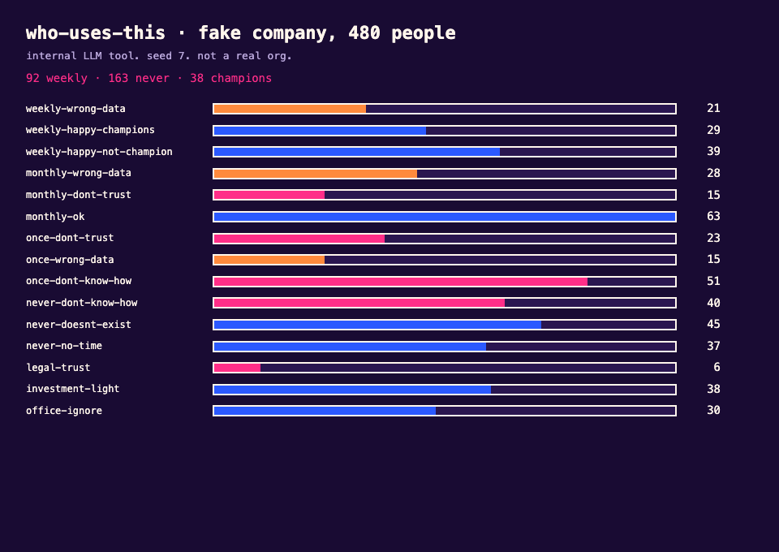
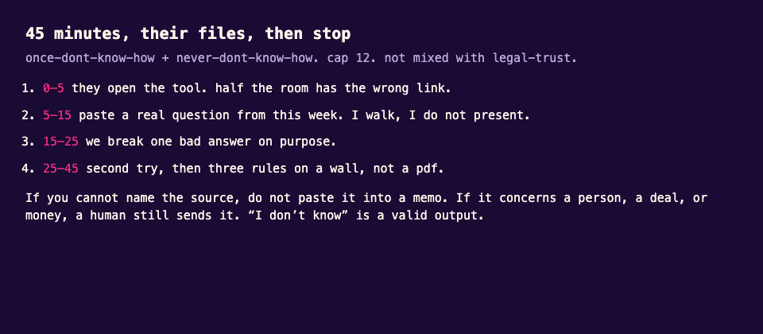

# who-uses-this

Internal tools die because twelve people use them every day and everyone else tried once in April.

I cannot publish the interviews or the usage dump. This is the method, on fake people:

1. ~480 accounts on an internal LLM tool
2. 16 segments I would actually write slack messages for
3. who gets a workshop, a one-liner, or peace

A json file and a markdown list I would paste into a meeting.

## run

```bash
python3 generate.py
python3 cluster.py
```

Writes `data/users.json` and `out/segments.md`.





`workshop.md` is 45 minutes with their own files.

## why 16

Three buckets (love / meh / never) are useless for outreach. Legal-never-tried and sales-never-tried need different sentences. Sixteen is already more than I want on a steering slide. I merge them at the table. The file stays split so I can argue.
